# Excel for Data Analysis — Organized Study Notes

> Based on your supplied IBM/Coursera Excel course text. Wording has been rewritten for clarity while keeping the original 15-topic structure and core concepts. All diagrams are newly drawn, illustrative examples—not actual Excel screenshots or assignment results.

**Course:** https://www.coursera.org/learn/excel-basics-data-analysis-ibm/lecture/kliGL/course-introduction

## Table of Contents

- [01. Excel Foundations](#01-excel-foundations)
- [02. Viewing, Entering, and Editing Data](#02-viewing-entering-and-editing-data)
- [03. Copying, Filling, and Formatting](#03-copying-filling-and-formatting)
- [04. Formula Basics and Functions](#04-formula-basics-and-functions)
- [05. Referencing Data in Formulas](#05-referencing-data-in-formulas)
- [06. Cleaning and Wrangling Data](#06-cleaning-and-wrangling-data)
- [07. Flash Fill and Text to Columns](#07-flash-fill-and-text-to-columns)
- [08. Filtering and Sorting Data](#08-filtering-and-sorting-data)
- [09. Functions for Data Analysts](#09-functions-for-data-analysts)
- [10. Visualizing Results](#10-visualizing-results)
- [11. Pivot Tables](#11-pivot-tables)
- [12. PivotTable Features: Slicers and Timelines](#12-pivottable-features-slicers-and-timelines)
- [13. Hands-on Labs and Junior Data Analyst Project](#13-hands-on-labs-and-junior-data-analyst-project)
- [14. Final Assignment — Part 1: Clean and Prepare](#14-final-assignment--part-1-clean-and-prepare)
- [15. Final Assignment — Part 2: Analyze](#15-final-assignment--part-2-analyze)

---

<a id="01-excel-foundations"></a>
## 01. Excel Foundations

**Workbook** is the `.xlsx` file; it contains one or more **worksheets** (tabs). A worksheet contains **columns** (A, B, C), **rows** (1, 2, 3), and **cells** (such as `B2`). A **range** uses a colon, for example `D9:D19`. The **Name Box** shows the selected cell reference and lets you jump to an address.

**Navigation:** `Ctrl+Home` → A1; `Ctrl+End` → last used cell; `Ctrl+Arrow` → edge of the current data region; `Ctrl+Shift+End` → extend selection to last used cell. `Ctrl+F1` toggles the ribbon. `Ctrl+PageDown` moves to the next sheet.

**Views:** Zoom changes magnification; **Freeze Panes** keeps selected headers/columns visible while scrolling; **Split** makes separately scrollable panes. In Excel for the web, available commands can differ from desktop Excel.

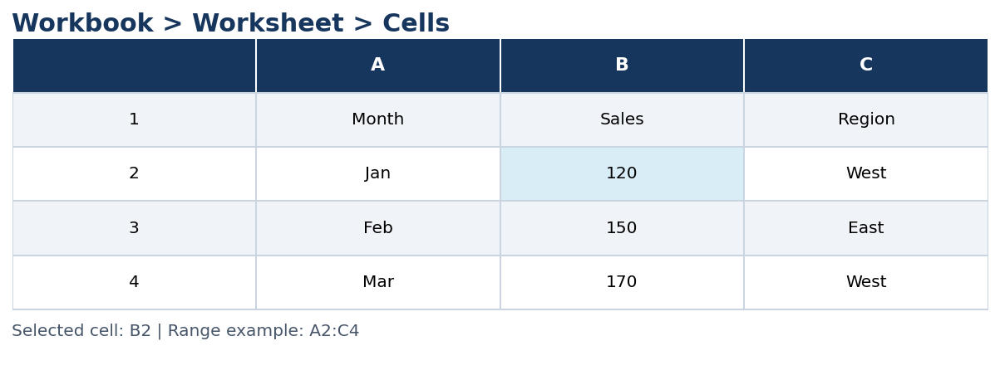

---

<a id="02-viewing-entering-and-editing-data"></a>
## 02. Viewing, Entering, and Editing Data

Press **Tab** after entering a cell to move right; press **Enter** to move down. Use `F2`, double-click, or the **Formula Bar** to edit an existing cell. Double-click the divider between column letters to **AutoFit** width. Use **View → Freeze Panes** to keep headers visible.

**Practice:** Create `Month`, `Housing`, `Food & Dining`, `Personal`, `Auto & Transport`, and `Health & Fitness` headers, then enter Jan–Apr in column A. Insert a column for `Bills & Utilities` and AutoFit all columns.


---

<a id="03-copying-filling-and-formatting"></a>
## 03. Copying, Filling, and Formatting

`Ctrl+C`, `Ctrl+X`, and `Ctrl+V` copy, cut, and paste. The small square at the bottom-right of the selected cell is the **Fill Handle**. Drag it to copy values or extend patterns (Jan, Feb, Mar). Enter two numbers (5, 10) to establish a +5 series. Double-click the Fill Handle to extend formulas alongside contiguous data.

**Cell formatting** controls appearance (bold, borders, colours); **number formatting** controls display (date, currency, decimals, percentage). Formatting a number as text does not necessarily correct an incorrectly imported value; verify the source.

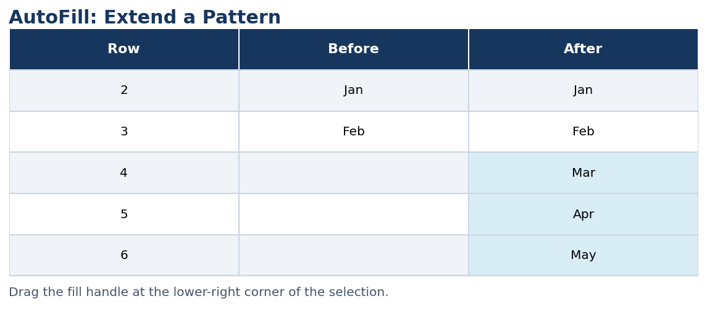

---

<a id="04-formula-basics-and-functions"></a>
## 04. Formula Basics and Functions

Every formula starts with `=`. Operators: `+`, `-`, `*`, `/`. A **range** like `B2:B13` is more efficient than listing each cell.

```excel
=SUM(B2:B13)
=AVERAGE(B2:B13)
=MIN(B2:B13)
=MAX(B2:B13)
=COUNT(B2:B13)
=MEDIAN(B2:B13)
=B15*20%
```

Use **AutoSum** (`Alt+=` on Windows) for a quick sum, then check Excel's proposed range. The course also introduces logical, text, lookup, date/time, and statistical function categories.

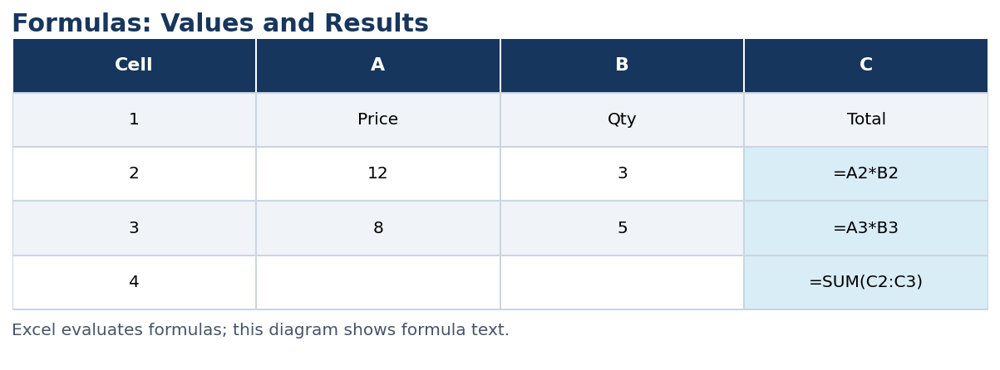

---

<a id="05-referencing-data-in-formulas"></a>
## 05. Referencing Data in Formulas

**Relative** reference `A2` changes when copied; **absolute** reference `$A$2` stays fixed; **mixed** references `$A2` or `A$2` lock only one dimension.

```excel
=C2*$F$1
```

When copied down, `C2` changes to `C3`, while `$F$1` remains unchanged. Review formula errors and check that number/date values are not accidentally stored as text.

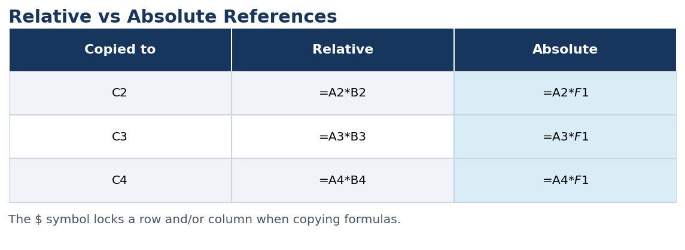

---

<a id="06-cleaning-and-wrangling-data"></a>
## 06. Cleaning and Wrangling Data

**Check data quality:** duplicates, missing values, misspellings, incorrect types, extra spaces, and inconsistent names. Import CSV carefully and verify columns and date formats. Preserve an original copy and respect data privacy.

**Useful operations:** Remove Duplicates, Find/Replace, Spell Check, filtering for blanks, and **TRIM** for extra spaces.

```excel
=TRIM(A2)
=PROPER(A2)
=UPPER(A2)
=LOWER(A2)
=LEFT(A2,3)
=RIGHT(A2,4)
=LEN(A2)
=SEARCH("-",A2)
```

**Important:** `TRIM` typically removes extra ordinary spaces but may not remove non-breaking spaces. Deleting blanks or duplicates requires checking what counts as a complete record.

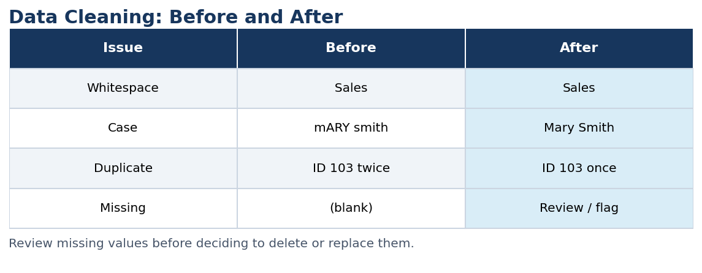

---

<a id="07-flash-fill-and-text-to-columns"></a>
## 07. Flash Fill and Text to Columns

**Flash Fill** detects a pattern from examples (for example, combining two name columns into one). **Text to Columns** separates values using a delimiter, such as a comma or space. Check a few output rows before deleting source columns.

**Fleet assignment example:** Department names were split across two columns during import; reconstruct the full department name using Flash Fill, validate against the provided department list, and remove redundant columns.

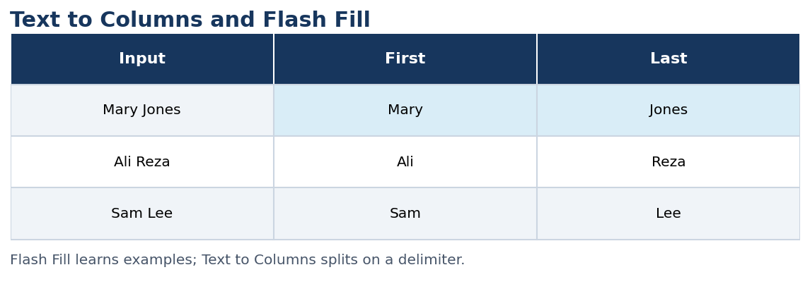

---

<a id="08-filtering-and-sorting-data"></a>
## 08. Filtering and Sorting Data

**Filter** temporarily hides rows that do not match selected criteria; it does not delete them. **Sort** reorders records alphabetically, numerically, by date, or with custom orders. Use **Sort Largest to Smallest** for sales rankings and **Filter for Blanks** to inspect empty records.

**Important:** Sort the entire table, not just one column, to avoid mismatching records. Clear filters when you need the full dataset again.

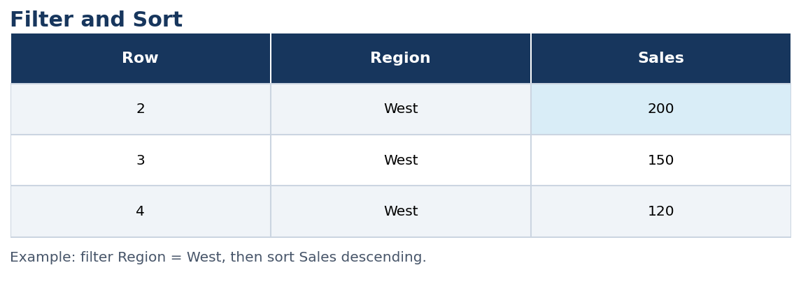

---

<a id="09-functions-for-data-analysts"></a>
## 09. Functions for Data Analysts

```excel
=IF(C2>=100,"Met","Not met")
=IFS(C2>=90,"High",C2>=60,"Medium",TRUE,"Low")
=COUNTIF(B2:B100,"Finance")
=SUMIF(B2:B100,"Finance",C2:C100)
```

**IF / IFS** apply conditions. **COUNTIF** counts matching rows. **SUMIF** sums values meeting a condition. **Conditional Formatting** visually highlights cells based on rules; it does not alter underlying data.

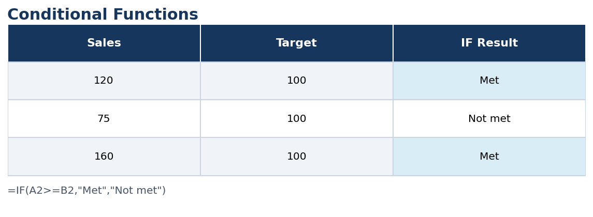

---

<a id="10-visualizing-results"></a>
## 10. Visualizing Results

Before making a chart, ask: **What is the question? Who is the audience? What comparison or trend matters? Is the data accurate?** Choose a chart suited to the task (bar for category comparison, line for time trends). Use clear titles, labels, and units. Avoid clutter and misleading axes.

**Example:** A bar chart of equipment count by department can reveal which department holds the largest share of the fleet.

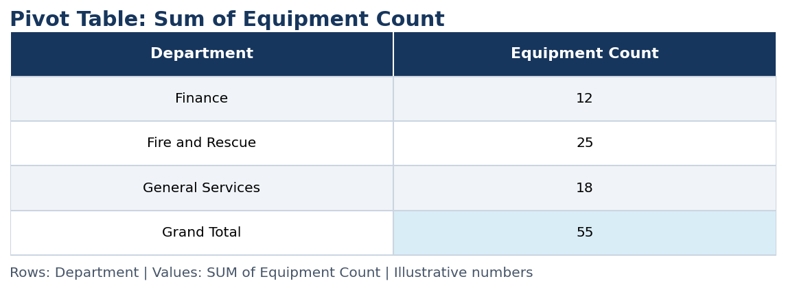

---

<a id="11-pivot-tables"></a>
## 11. Pivot Tables

A **PivotTable** summarizes records into categories without writing separate formulas for every group. Use **Insert → PivotTable** and drag fields into **Rows**, **Columns**, **Values**, or **Filters**.

**Example:** `Department` → Rows; `Equipment Count` → Values (**Sum**, not Count). Sort the totals descending. If the source data changes, **refresh** the PivotTable to update its displayed summary.

**Checklist:** one header row, clear field names, no blank rows/columns inside the table, correct numeric/date types, and a clean source range.


---

<a id="12-pivottable-features-slicers-and-timelines"></a>
## 12. PivotTable Features: Slicers and Timelines

**Recommended PivotTables** suggest useful field arrangements. **Slicers** provide clickable filters for categories such as Department. **Timelines** filter date fields by years, quarters, months, or days. **Expand/Collapse** controls levels of detail in hierarchical PivotTables.

**Example:** Put `Department` above `Equipment Class` in Rows to see equipment classes within each department. Reverse their order to group departments within each class.

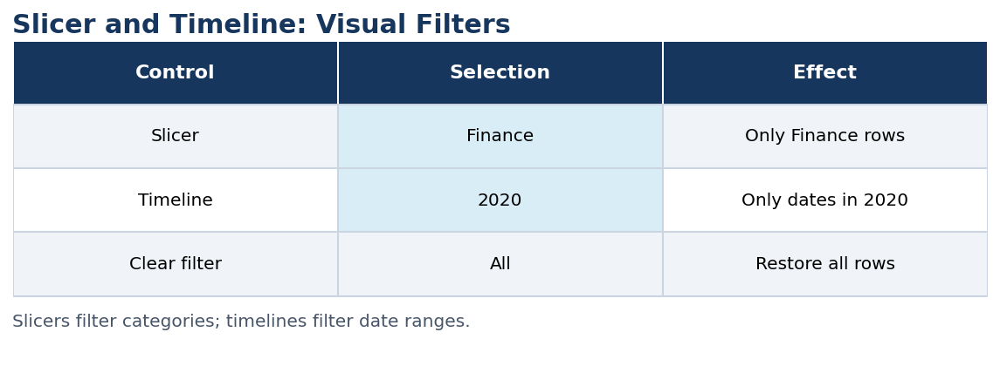

---

<a id="13-hands-on-labs-and-junior-data-analyst-project"></a>
## 13. Hands-on Labs and Junior Data Analyst Project

The supplied IBM course notes include seven hands-on labs:

1. Excel for the web: sign in, upload, and open a workbook.
2. Spreadsheet basics: worksheets, cells, ranges, ribbon, navigation.
3. Data entry, editing, copying, AutoFill, and formatting.
4. Formulas and functions.
5. Cleaning data.
6. Filtering and sorting.
7. PivotTables, slicers, and timelines.

**Course datasets:** a modified Indian startup funding dataset for introductory labs, and a fleet equipment inventory dataset for the final assignment. Use the **course-provided modified files** when following lab instructions.

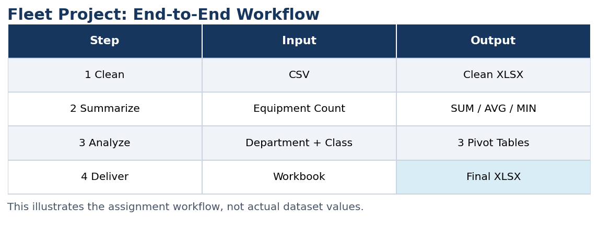

---

<a id="14-final-assignment--part-1-clean-and-prepare"></a>
## 14. Final Assignment — Part 1: Clean and Prepare

**Scenario:** You are a Junior Data Analyst in a local government office. Import a fleet inventory CSV and prepare it for analysis.

1. Convert the provided CSV into `.xlsx`.
2. AutoFit column widths.
3. Filter for and remove **fully empty rows** after checking them.
4. Identify and remove duplicate records.
5. Check spelling.
6. Replace double spaces and check whitespace.
7. Recombine split department names with Flash Fill; validate against the course's department list.
8. Download as `Montgomery_Fleet_Equipment_Inventory_FA_PART_1_END.XLSX`.

Keep the original CSV and verify the cleaned dataset before submission.


---

<a id="15-final-assignment--part-2-analyze"></a>
## 15. Final Assignment — Part 2: Analyze

1. Open the course's **Part 2 START** workbook; format source data as a table.
2. Use AutoSum on column C to calculate **SUM, AVERAGE, MIN, MAX, COUNT**.
3. Create **Pivot Table 1**: `Department` in Rows, **Sum of Equipment Count** in Values; sort descending.
4. Create **Pivot Table 2**: `Department` above `Equipment Class`; collapse all except **Transportation**.
5. Create **Pivot Table 3**: `Equipment Class` above `Department`; collapse all except **CUV**.
6. Order sheets: source data, Pivot Table 1, Pivot Table 2, Pivot Table 3.
7. Download as `Montgomery_Fleet_Equipment_Inventory_FA_PART_2_END.XLSX`.

The illustrated values are examples only; calculate actual results from your assignment workbook.


---

## Useful Keyboard Shortcuts

| Action | Windows shortcut |
|---|---|
| Save | `Ctrl+S` |
| Copy / Paste | `Ctrl+C` / `Ctrl+V` |
| Undo | `Ctrl+Z` |
| Edit cell | `F2` |
| Go to A1 | `Ctrl+Home` |
| Last used cell | `Ctrl+End` |
| Navigate data region | `Ctrl+Arrow` |
| Select to last used cell | `Ctrl+Shift+End` |
| Next worksheet | `Ctrl+PageDown` |
| AutoSum | `Alt+=` |
| Toggle ribbon | `Ctrl+F1` |

## Source and Attribution

This is a condensed, reorganized study guide based on the text you provided, not a reproduction of the entire course. Your complete pasted course text is preserved in `COURSE_SOURCE.txt` for reference. Diagrams were independently generated for these notes.

**Dataset source mentioned in the course:** [Montgomery County Fleet Equipment Inventory](https://data.montgomerycountymd.gov/Government/Fleet-Equipment-Inventory/93vc-wpdr).